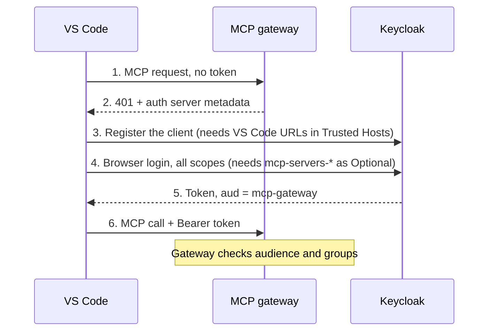

# MCP Gateway: Keycloak + VS Code OAuth setup

## Overview

VS Code can sign in to the MCP gateway through Keycloak with no token pasted by hand, once three things are configured in the `mcp-gateway` realm. With the default setup, sign-in fails and VS Code falls back to asking for a client ID.



Steps 3 and 4 are the two that need Keycloak changes; the rest work out of the box.

What VS Code does when it connects to `http://localhost/microsoft-learn/mcp` with no token:

1. The gateway answers `401` with a `WWW-Authenticate` header.
2. VS Code reads `http://localhost/.well-known/oauth-authorization-server` and finds Keycloak (`http://localhost:8080/realms/mcp-gateway`) and its registration endpoint.
3. VS Code registers itself as a new public client (dynamic client registration). Keycloak's **Trusted Hosts** policy must allow `vscode.dev`, `*.vscode.dev` and `code.visualstudio.com`, or registration fails.
4. VS Code opens the Keycloak login page and asks for every scope the realm advertises, including the four `mcp-servers-*` scopes. Those scopes must be available to new clients, or Keycloak rejects the request with `Invalid scopes`.
5. Keycloak returns a token. The gateway accepts it only if its audience is `mcp-gateway` and the user's groups grant access to the server.

If step 3 or 4 fails, VS Code shows *"Dynamic client registration not supported… provide a client ID"*. Don't type anything there. Fix Keycloak instead.

## Prerequisites

The gateway stack from `mcp-gateway-registry` must be running, and you need the Keycloak admin login plus one user in the `mcp-gateway` realm.

| What | Where |
| --- | --- |
| MCP gateway (registry) | `http://localhost` (container `mcp-gateway-registry-registry-1`) |
| Keycloak | `http://localhost:8080` (container `mcp-gateway-registry-keycloak-1`, Keycloak 25) |
| Keycloak admin console | `http://localhost:8080/admin`, **master** realm |
| Admin user | `admin` |
| Admin password | `KEYCLOAK_ADMIN_PASSWORD` in `.env` |
| Realm VS Code signs in to | `mcp-gateway` (the gateway setup creates it) |

Check the containers are up:

```bash
docker ps --format '{{.Names}}' | grep mcp-gateway-registry
```

Read the admin password from the running container (it's never shown in this guide):

```bash
docker exec mcp-gateway-registry-keycloak-1 printenv KEYCLOAK_ADMIN_PASSWORD
```

The master-realm `admin` can't sign in from VS Code. You need a user created **inside** the `mcp-gateway` realm.

## Configure Keycloak

Four changes in the `mcp-gateway` realm let VS Code register itself and sign in. Log in to `http://localhost:8080/admin` as `admin`, then pick **mcp-gateway** in the realm dropdown at the top left.

Shortcut: [`keycloak/setup/configure-vscode-dcr.sh`](../keycloak/setup/configure-vscode-dcr.sh) applies steps 1 and 2 for you. It's idempotent, and `--dry-run` shows what it would change. Steps 3 and 4 stay manual.

```bash
./keycloak/setup/configure-vscode-dcr.sh --dry-run
```

### 1. Trust VS Code's URLs for client registration

1. Go to **Clients** → **Client registration** tab → **Anonymous access policies**.
2. Click the **Trusted Hosts** row (it's a link in the list, not a tab).
3. Under **Trusted Hosts**, add each of these (one per line, using **Add trusted hosts**):
   - `vscode.dev`
   - `*.vscode.dev`
   - `code.visualstudio.com`
4. Keep `localhost` / `127.0.0.1` if they're already listed.
5. Turn **Host sending client registration request must match** **off**. Registration requests reach Keycloak from the Docker bridge address (e.g. `172.22.0.1`), which is never a trusted host.
6. Leave **Client URIs must match** on.
7. Click **Save**.

Why: VS Code's registration request carries the redirect URIs `http://127.0.0.1:33418/` and `https://vscode.dev/redirect`, plus `client_uri: https://code.visualstudio.com`. Each of these hosts must be trusted.

### 2. Make the gateway scopes available to new clients

1. Go to **Client scopes** in the left menu.
2. Set **Assigned type** to **Optional** for each of these:
   - `mcp-servers-unrestricted/read`
   - `mcp-servers-unrestricted/execute`
   - `mcp-servers-restricted/read`
   - `mcp-servers-restricted/execute`
3. Make sure `basic` is still **Default**. Its audience mapper puts `mcp-gateway` in the token's `aud`, and the gateway rejects tokens without it.

If login still fails with `Invalid scopes`, open **Clients** → **Client registration** → **Anonymous access policies** → **Allowed Client Scopes** and add the same four scopes there.

### 3. Give your user access

1. **Users** → **Add user** (skip this if you already have one in `mcp-gateway`). Set a password on the **Credentials** tab, with **Temporary** off.
2. On the user's **Groups** tab, join the group that grants access to the servers you need, for example `mcp-servers-unrestricted`.

### 4. Remove stale clients

Every failed attempt can leave a client whose name is a random UUID. Under **Clients**, delete any client named with a random UUID from an attempt made before steps 1 and 2 (it lacks the new scopes).

Don't delete the gateway's own clients (e.g. `mcp-gateway-web` and the M2M client).

## Set up VS Code

Add the server without an `Authorization` header, clear any saved client, then approve the sign-in when VS Code asks.

### 1. Add the server

In `.vscode/mcp.json` (workspace) or your user `mcp.json` (**MCP: Open User Configuration**):

```json
{
  "servers": {
    "Microsoft Learn": {
      "type": "http",
      "url": "http://localhost/microsoft-learn/mcp"
    }
  }
}
```

Don't set a `headers` / `Authorization` entry. If VS Code sends a token, even an expired one, it uses that token instead of the Keycloak sign-in.

### 2. Clear the saved client (after any failed attempt)

1. Command Palette → **Authentication: Remove Dynamic Authentication Providers**.
2. Remove the `localhost:8080/realms/mcp-gateway` entry.

This drops the client ID VS Code saved from an earlier attempt, e.g. one typed at the client ID prompt.

### 3. Start the server and approve sign-in

1. Click **Start** (or **Restart**) above `"Microsoft Learn"` in `mcp.json`, or run **MCP: List Servers** → **Microsoft Learn** → **Start Server**.
2. VS Code waits for your approval before it opens a browser. The MCP output meanwhile shows `Waiting for server to respond to initialize request...`. Look for the prompt in one of these places:
   - **Accounts** icon (bottom of the left Activity Bar) with a **1** badge → **Sign in with … to use Microsoft Learn**
   - a dialog or notification *"… wants to authenticate"* → **Allow**
3. The browser opens the **mcp-gateway** login page. Sign in with your realm user.
4. The browser says you can close the tab, and the server's status turns to **Running** in VS Code.

The token refreshes automatically (`offline_access` is among the requested scopes). You won't need to paste tokens again.

## Alternative: a static token

Without the Keycloak sign-in you can paste a token from the registry UI, but it expires quickly. When it expires, VS Code starts the OAuth flow described above.

1. Open `http://localhost`, sign in, and generate a token (**Get JWT Token**).
2. Declare an input and send it as a header:

```json
{
  "inputs": [
    { "type": "promptString", "id": "mcpgw-token", "description": "MCP Gateway token", "password": true }
  ],
  "servers": {
    "Microsoft Learn": {
      "type": "http",
      "url": "http://localhost/microsoft-learn/mcp",
      "headers": { "Authorization": "Bearer ${input:mcpgw-token}" }
    }
  }
}
```

3. When the token expires, the gateway logs `Self-signed token has expired`. To be asked for a new token, rename the input `id` (e.g. `mcpgw-token2`) in both places, or clear VS Code's stored input values.

## Troubleshooting

Most failures show up in the Keycloak or auth-server log before VS Code says anything useful.

| What you see | Log line | Cause | Fix |
| --- | --- | --- | --- |
| Keycloak error page, `client_id` in the URL is `http://localhost:33418 https://vscode.dev/redirect` | `error="client_not_found"` | Redirect URIs were typed into the client ID prompt | Remove the saved client (VS Code step 2) and fix Keycloak first |
| VS Code: *Dynamic client registration not supported … provide a Client ID* | `Policy 'Trusted Hosts' rejected … URL 'https://code.visualstudio.com' doesn't match` | A VS Code URL isn't in Trusted Hosts | Keycloak step 1, add the host named in the log |
| Same prompt, after the browser briefly opens | `LOGIN_ERROR … reason="Invalid scopes: … mcp-servers-…"` | New clients lack the `mcp-servers-*` scopes | Keycloak step 2, then delete that client (step 4) |
| MCP output stuck on `Waiting for server to respond to initialize` | No new Keycloak events | VS Code is waiting for your approval | Accounts icon badge → **Sign in** (VS Code step 3) |
| Server returns 401 after sign-in | `Token validation failed` | Token audience isn't `mcp-gateway` | Keep `basic` as a Default client scope |
| Server returns 403 after sign-in | — | User isn't in a group that grants the server | Keycloak step 3 |
| Static token stops working | `Self-signed token has expired` | Registry tokens are short-lived | New token, or switch to the Keycloak sign-in |

Watch Keycloak's login and registration events:

```bash
docker logs -f mcp-gateway-registry-keycloak-1 2>&1 | grep -E 'KC-SERVICES|CLIENT_REGISTER|LOGIN_ERROR'
```

Watch the gateway's token checks:

```bash
docker logs -f mcp-gateway-registry-auth-server-1 2>&1 | grep -E 'WARNING|ERROR|validate'
```

The gateway's `/.well-known/oauth-protected-resource` returns 500. VS Code works around it through `/.well-known/oauth-authorization-server`, so sign-in isn't blocked.
